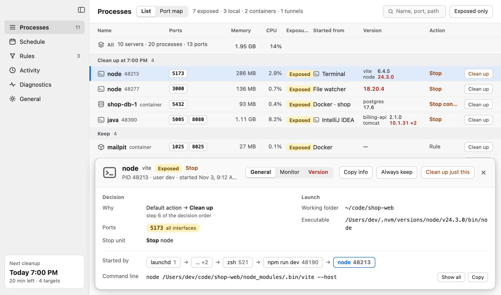

# MyLocal

Laptops don't sleep at night anymore. MyLocal stops the dev servers left running all night, with a warning first.

<picture>
  <source media="(prefers-color-scheme: dark)" srcset="https://raw.githubusercontent.com/my-locals/.github/main/profile/processes-dark.webp">
  
</picture>

```bash
brew tap my-locals/mylocal
brew trust --tap my-locals/mylocal
brew install --cask mylocal
```

Free. macOS 13 or later, Apple silicon. [Website](https://mylocal.myiam.io)

| | |
|---|---|
| [mylocal](https://github.com/my-locals/mylocal) | Bugs, ideas and security reports, in English or 한국어 |
| [homebrew-mylocal](https://github.com/my-locals/homebrew-mylocal) | Install and releases |
| [mylocal-plugin](https://github.com/my-locals/mylocal-plugin) | Skill for AI coding agents |
| [mylocal-data](https://github.com/my-locals/mylocal-data) | Signed support and advisory data |

The app's source code is not public.
